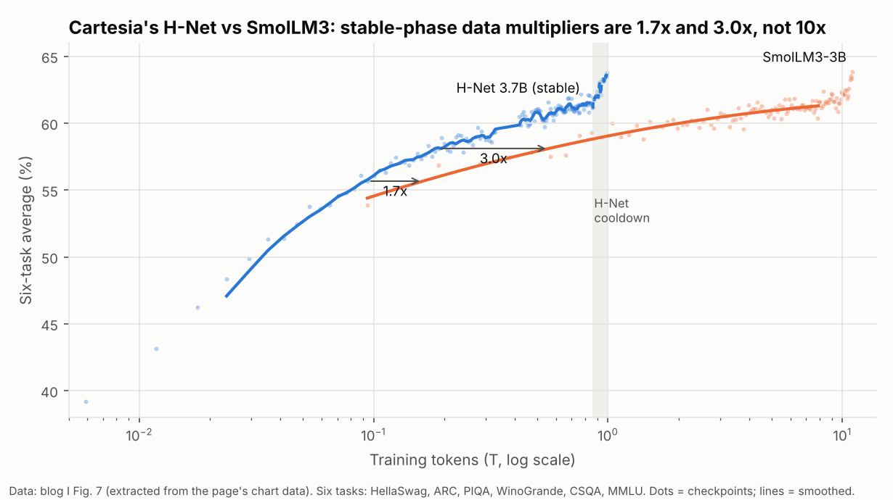
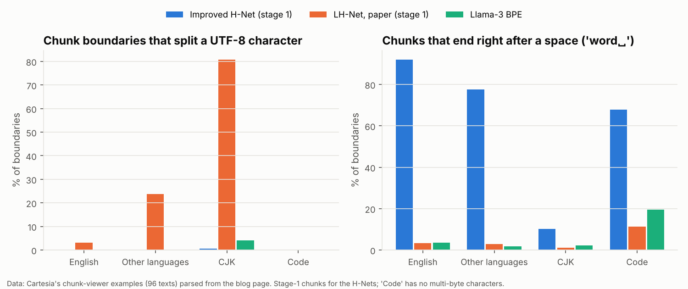
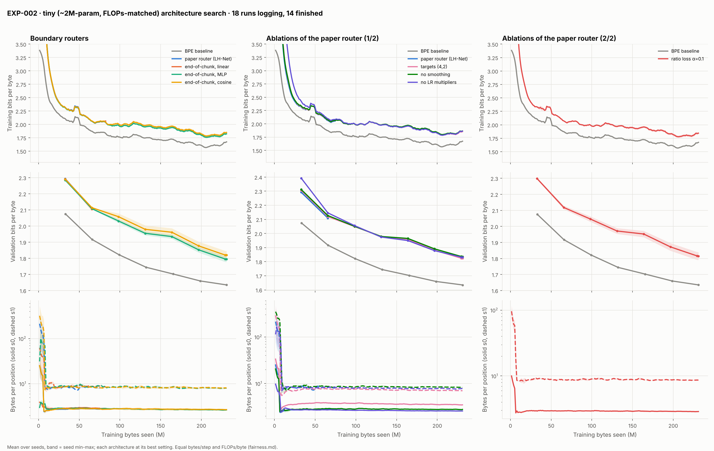

# Experiment log

One entry per experiment: what was tried, the exact config, hardware, cost, results and figures. Newest entries at
the bottom. Figures are in `logbook/figures/`; the script that made each figure is named in its entry.

Status legend: **planned** · **running** · **done** · **failed** · **abandoned**

| ID | Title | Status | Cost | Headline |
|---|---|---|---|---|
| EXP-000 | Cartesia Fig. 7 re-analysis (reference data, no training) | done | $0 | Stable-phase data multiplier ≈ 1.7x at 94B tokens and ≈ 3.0x at 189B; the 10x needs the H-Net cooldown |
| EXP-001 | What the blog's chunk-viewer data says about the improved router | done | $0 | Boundaries mark chunk ENDS (causal); stage-1 chunks are 'word␣' and almost never split words or UTF-8 characters |
| EXP-002 | Tiny (~2M) architecture search: routers and ablations vs BPE | running | ~$2 est. | (in progress) |

---

## EXP-000 · Cartesia Fig. 7 re-analysis

*2026-10-28 · status: done · cost: $0 · script: `logbook/exp000_reference.py`*

**Question.** How much of the blog's ">10x fewer tokens" comes from the architecture, and how much from comparing a
cooled-down H-Net with a stable-phase SmolLM3?

**Data.** The per-checkpoint scores behind blog I Fig. 7, extracted from the page's chart bundle into
`configs/reference/blog1_fig7_{hnet,smollm3}.csv`:
* the H-Net has 154 points to 0.99T tokens (cooldown from 0.855T);
* SmolLM3 has 117 points to 11.04T (stage 1 up to 7.93T).

The six tasks are HellaSwag, ARC, PIQA, WinoGrande, CSQA and MMLU.

**Method.** Fit SmolLM3's stage-1 (stable-LR) average as a quadratic in log tokens. For each stable-phase H-Net point,
find the SmolLM3 token count that reaches the same score.

**Results.**

| H-Net tokens | H-Net avg | SmolLM3 avg at same tokens | SmolLM3 tokens to match (smoothed) | Data multiplier |
|---|---|---|---|---|
| 94B | 55.66 | 53.87 | 162B | **1.7x** |
| 189B | 58.11 | 56.86 | 560B | **3.0x** |
| 301B | 58.74 | — | 822B | 2.7x |
| 0.99T (after cooldown) | 63.82 | — | 11.04T (SmolLM3 final, after stages 2–3) | 11x |



**Takeaways.**
* The architecture effect at matched stable phase is real but ~2–3x, not 10x. The H-Net's cooldown adds ~2.3 points
  (61.5 → 63.8).
* Our pass criteria for any H-Net vs baseline comparison use stable-vs-stable multipliers. Cooldown is a separate,
  explicitly labelled branch.
* Cartesia's SmolLM3 Winogrande (63.69 at the end) differs from the model card (58.88), so their eval setup differs from
  the card. Our harness is validated against these CSV numbers, not the card.

---

## EXP-001 · What the blog's chunk-viewer data says about the improved router

*2026-10-28 · status: done · cost: $0 · scripts: `scripts/reference/parse_chunk_viewer.py`,
`scripts/reference/analyze_chunk_viewer.py`, `logbook/exp001_chunk_viewer.py`*

**Question.** The blog's H-Net is unreleased and differs from the paper's (which the blog calls "LH-Net",
lazy/lookahead). What does its router actually do?

**Data.** Blog I Figs. 10–11 are interactive viewers. Their data files hold 96 texts (45 natural-language, 51 code)
with, for each text:
* the improved H-Net's stage-0/1 boundary positions and per-byte boundary probabilities p;
* LH-Net's boundaries on the same texts;
* Llama-3 and in-corpus BPE tokenizations.

These were parsed as data (no page code was executed) into `configs/reference/chunk_viewer.json`. The viewer code
labels an improved-H-Net boundary byte "ends here" (`ends: true` on every example) and a trailing chunk without one
"unfinished".

**Results.**
* **End-of-chunk boundaries.** p ≥ 0.5 coincides with "this byte is the last byte of a stage-0 chunk" on 99.76% of
  327,081 bytes. The decision at byte t can only use bytes ≤ t, so there is no lookahead.
* **Spaces go at the end of chunks.** 92% (English), 78% (other languages) and 68% (code) of stage-1 chunks end right
  after a space. LH-Net and BPE attach the space to the next word instead (≤ 20%).
* **Clean stage-1 units.**

  | Stage-1 cuts | English | Other languages | CJK |
  |---|---|---|---|
  | Inside a word: improved H-Net | 0% | 0.5% | — |
  | Inside a word: LH-Net | 3% | 3% | — |
  | Inside a UTF-8 character: improved H-Net | 0% | 0.01% | 0.5% |
  | Inside a UTF-8 character: LH-Net | 3% | 24% | 81% |
  | Inside a UTF-8 character: Llama-3 BPE | 0.2% | 0.07% | 4% |

  This confirms the blog's CJK claim quantitatively.
* **Compression (bytes per stage-1 chunk):**

  | Model | English | Other languages | CJK | Code |
  |---|---|---|---|---|
  | Improved H-Net | 7.0 | 9.7 | 4.3 | 7.0 |
  | LH-Net | 7.4 | 7.0 | 3.6 | 7.4 |
  | Llama-3 BPE | 4.5 | 4.5 | 3.6 | 4.0 |

* **Boundary probabilities are bimodal** (most mass below 0.1 or above 0.9), with a tail in between.

Example (first 96 bytes of the English example, ␣ = space):

```
H-Net s0 : Ever␣|wonder|ed␣|if␣|you|␣|could␣|beat|␣|a␣|bear|␣|or␣|a␣|horse|␣|in␣|a␣|race|?|␣|What|␣|about␣|a␣|rat␣|or␣|a␣|rh|ino|?|␣|The␣|an
H-Net s1 : Ever␣|wondered␣|if␣|you␣could␣|beat␣|a␣bear␣|or␣|a␣horse␣|in␣|a␣race?␣|What␣|about␣|a␣rat␣|or␣|a␣rhino?␣|The␣|an
LH-Net s0: Ever|␣wondered|␣i|f␣you|␣could|␣be|at|␣a|␣be|ar|␣or|␣a|␣ho|rse|␣i|n␣a|␣ra|ce|?␣|What|␣about|␣a|␣rat|␣or|␣a|␣r|hino|?␣|The|␣an
LH-Net s1: Ever|␣wondered|␣i|f␣you␣could␣beat|␣a␣bear|␣or|␣a␣horse|␣in␣a|␣race|?␣What|␣about|␣a␣rat|␣or|␣a␣rhino|?␣The␣an
Llama-3  : Ever|␣wondered|␣if|␣you|␣could|␣beat|␣a|␣bear|␣or|␣a|␣horse|␣in|␣a|␣race|?|␣What|␣about|␣a|␣rat|␣or|␣a|␣rh|ino|?|␣The|␣an
```



**What we implement from this.**
* Routers declare start or end boundary semantics.
* With end semantics, the chunk vector is the last byte's state, and byte t reads the most recent chunk that ended at
  or before t.
* The router function is still a guess. Candidates `end_linear`, `end_mlp` and `end_cosine_shift` go through the
  1–10M architecture search (PLAN §2b), with the chunk statistics above as the targets for our trained models.

---

## EXP-002 · Tiny architecture search: routers and ablations vs BPE

*2026-10-29 · status: done · hardware: spot L4s (GCP), 3 runs in parallel per VM · spec:
`configs/search/exp002_tiny2m.yaml` · commits f988ba8 … 9e9f8c4 · fairness: `runs/search/exp002_tiny2m/fairness.md`*

**Question.** At tiny scale and equal FLOPs/byte and data:
* does the paper's 2-stage H-Net beat the BPE baseline;
* does an end-of-chunk router (the blog's design, EXP-001) beat the paper's lookahead router;
* which paper components matter?

**Setup.** Nine variants, each with 2 seeds.
* **Baseline:** BPE (GPT-2 tokenizer, 15M params incl. a 50K-vocab head).
* **H-Nets** (~7.9M params, 2-stage, (3,3)), with these routers:
  * the paper's `cosine_lookahead`;
  * three end-of-chunk guesses: `end_linear`, `end_mlp` and `end_cosine_shift`.
* **Ablations of the paper router:**
  * targets (4,2);
  * no smoothing;
  * no per-stage LR multipliers;
  * ratio-loss α = 0.1.

All runs share:
* **Data:** FineWeb-Edu train shard 1 in the same window order; 231M bytes per run (50M token-equivalents).
* **Optimizer:** AdamW, peak LR 1.5e-3, WSD (10% warmup, 20% inverse-sqrt decay), bf16, no compile.
* **Evaluation:** the same 1 MB val text for bpb, plus paper7 task metrics every 500 steps.

**Results** (all 18 runs done; `logbook/tables/exp002_summary.md`, figure re-rendered by `logbook/exp002_progress.py`).



| variant | val bpb (2 seeds) | realized compute vs budget |
|---|---|---|
| BPE baseline | **1.635** | 0% |
| paper router (LH-Net) | 1.78–1.80 | +7% to +12% |
| end-of-chunk MLP | 1.78–1.81 | +3% |
| end-of-chunk cosine / linear | 1.79–1.85 | |
| ablations (targets 4/2, no smoothing, no LR multipliers, α 0.1) | 1.82–1.84 | |

* Every H-Net trails BPE by 0.15–0.21 bpb at this ~2M-parameter scale; the variants differ by less than the
  seed spread (up to 0.05), so EXP-002 cannot rank routers or ablations. Three seeds from EXP-003 on.
* All H-Nets show a transient early router collapse (stage 1 up to ~300 bytes/position) that recovers by ~10M
  bytes; the paper-router runs then settle ~7% *below* their target compression, i.e. over the FLOPs budget
  (found later; see the realized-compute note under EXP-010).
* Two infrastructure bugs were found and fixed on the way: a CUDA illegal memory access in flex attention's
  compiled block-mask builder on per-step packed lengths, and a thread-safety race in Triton's autotuner when two
  post-run diagnostics ran at once.

## Mechanism study (between EXP-002 and the fix sweeps)

*Tools: `hnet/analysis/diagnose.py`, `probe_texts.py`, `probe_main.py`, `main_signal.py`; a per-step probe run
(`logbook/figures/probe_dynamics.png`); details and tables in `logbook/WORKLOG.md`.*

1. **The hierarchy is barely used.** Zeroing the innermost main network (6.0M of 7.9M params, 38% of FLOPs) costs
   0.04 bpb; zeroing everything below stage 0 costs 0.69. The main network's gradient norm drops to 1–3% of
   stage 0's within 20 steps in every variant.
2. **Why (per-step probe run):** the residual bypass starts at zero, so at init the decoder sees only the untrained
   hierarchy; the stage-0 router switches it off (47 bytes/chunk by step 20) and the main network's gradient falls
   17×; the ratio loss forces compression back, stage 1 collapses in turn, and by step 80 the residual path has
   overtaken the hierarchy signal. From then on the stage-1 router drifts to coin flips (46–70% of p in 0.4–0.6).
3. **The chunk vector is a boundary state, not a chunk summary.** Probes on the main network's input: with the
   end-of-chunk router it encodes the chunk's last byte almost losslessly (0.18 bits) but its first byte barely
   (3.3–3.6 of 4.8 bits left, even with an MLP probe). The main network does not know which word it sees. With the
   paper's start semantics the vector encodes the first byte and nothing of the chunk (a one-chunk lag).
4. **Not a decoder bottleneck, not a noisy gradient.** The main network's output is *less* predictive than its input
   (2.62 vs 2.08 bits), and its gradient SNR at the training batch is normal (2.4 at step 500 vs 1.9 for stage 0).
5. **84% of the gap to BPE** (token-aligned on identical text) is in the letters of "space+word" tokens: word
   identity.
6. **Routers run over budget.** The LM loss pulls every router toward more boundaries (dCE/dshift < 0 at stage 0 in
   all models); the α = 0.03 ratio loss pushes back 2.5–4× more weakly, so compression settles 10–16% above the
   FLOPs budget. At stage 1 both gradients are ~1e-4: the router is unconstrained, and at lr ≥ 3e-3 it becomes a
   limit cycle between select-all and select-none (`logbook/figures/exp003_collapses.png`).
7. **Neither model copies in context** at ~50M tokens (repeated phrases still cost ~2 bits/byte): this regime
   is for mechanisms, not for the final verdict.

## EXP-003 · AdamW learning-rate sweep (tuned fairness)

*spec `configs/search/exp003_lr_adamw.yaml` · 4 architectures × LR {5e-4 … 6e-3} × 3 seeds = 60 runs · status:
~40/60 done · partial report `logbook/reports/exp003_partial/`*

**Result so far.** BPE's best LR is 6e-3, at the grid edge (1.564 ± 0.012); every H-Net peaks at 1.5e-3
(1.78–1.80) and degrades above it because of the stage-1 limit cycle (finding 6). At tuned settings the gap is
0.235 bpb, not 0.17. The paper's LR multipliers put stage 0 at 3.5× base and the main network at 0.72×.

## EXP-006 · Parameter matching with hashed n-gram embeddings

*spec `configs/search/exp006_close_gap_tiny.yaml` · BPE vs 1-/2-stage H-Net ± FLOP-free n-gram tables matching
BPE's 15M parameters · 3 seeds · status: ~12/18 done*

| arm | val bpb | realized compute |
|---|---|---|
| BPE | 1.634 ± 0.002 | |
| 2-stage paper router | 1.795 (1 seed) | +11.7% |
| 2-stage + n-gram | **1.714 ± 0.016** | +1.2% |
| 1-stage learned router | 1.845 ± 0.002 | +5.8% |
| 1-stage + n-gram | **1.705** (1 seed) | +0.7% |

**Finding.** ~40% of the gap is BPE's free vocabulary table. But the gain lands in the byte stage (punctuation,
word-internal bytes), not in the hierarchy: the main network's contribution *drops* (0.63 → 0.38 bpb).

## EXP-009 · Oracle chunking: is routing the bottleneck?

*spec `configs/search/exp009_oracle_chunks.yaml` · 1-stage H-Net with hand-made boundaries at identical FLOPs ·
3 seeds · status: done*

| boundaries (6 bytes/chunk) | val bpb | main-network contribution |
|---|---|---|
| fixed every 6 bytes | 1.859 ± 0.007 | 0.25 |
| learned (EXP-006 hnet1) | 1.845 ± 0.002 | |
| oracle word starts | 1.827 ± 0.006 | 0.45 |
| oracle word ends | **1.806 ± 0.026** | **0.56** |

**Finding.** Chunk semantics decide how much the hierarchy is used (end > start > fixed), but even oracle word
chunks are only 0.04 better than the learned router and 0.17 behind BPE: routing is not the main gap here.

## EXP-008 · Training signals for the hierarchy (paper router) · EXP-011 · the same with fixed (3,3) pooling

*specs `exp008_hierarchy_use.yaml`, `exp011_fixed_hourglass.yaml` · residual path-drop, main-path auxiliary head,
router-entropy penalty, identity-init residual, residual warmup · 3 seeds · status: running*

**So far (1 seed each):** path-drop alone hurts (1.895; hierarchy dead); the aux head alone is marginal (1.821 vs
1.823); the entropy penalty is harmful: it drives the routers to select almost everything (`combo_end` reached
1.652 at **+379% FLOPs**, i.e. invalid, and the paper-router `combo` ran out of memory the same way). Both
`combo` arms were dropped from the spec.

## EXP-010 · Dynamics fixes and Mamba-free outer networks

*spec `exp010_dynamics_and_mixers.yaml` · strong ratio loss (α 1), identity residual, both; outer Mamba-2 replaced
by sliding-window attention (+1.1% FLOPs) or Kimi Delta Attention (+0.3%) · 3 seeds · status: running (the KDA
arm first failed on a kernel channel-count constraint, fixed)*

**So far:** `alpha1` 1.818 at +0.8% compute: the strong ratio loss holds compression, and the paper router's
apparent edge over fixed chunks (1.823) was extra compute. `resid_id` 1.783 but at +15.6% compute.

## EXP-012 · Chunk vectors that summarize the chunk (pooling chunker)

*spec `exp012_pool_chunker.yaml` · end-of-chunk router with select vs mean-pool vs attention-pool chunk vectors
(`hnet/model/chunking/pool.py`), ± residual warmup · 3 seeds · status: running (first attempt of the attention
arms crashed on a bf16 dtype mismatch under autocast; fixed and relaunched)*

## EXP-013 · Can the H-Net use BPE's learning rate?

*spec `exp013_lr_allocation.yaml` · lr 6e-3 with: paper multipliers, strong ratio loss, entropy penalty, no
multipliers, main-heavy multipliers [1, 1, 4] · 3 seeds · status: running*

## EXP-014 · Rank-based (quantile) boundary decisions

*spec `exp014_quantile_decision.yaml` · `hnet/model/routing/decide.py`: select the top 1/N positions by p (batch
quantile, running threshold for eval, p recentred so the threshold is 0.5). Compression is pinned exactly and the
ratio loss becomes inert. Arms: quantile, quantile + attention pooling, each at lr 1.5e-3 and 6e-3 · 3 seeds ·
status: **stopped at step ~500, invalid** (see work log: the p-space quantile saturated and collapsed the selection in
most runs; the decider was rewritten to rank batch-normalized fp32 logits and is validated as the `quant_fix` arm of
EXP-017). EXP-015/016 were built on the same rule and were stopped with it; they will be re-run on the fixed rule only
if EXP-017 says the hierarchy is worth more training signals.*

## EXP-015 · Which training signals make the hierarchy carry the model, at honest compute

*spec `exp015_hierarchy_factorial.yaml` · end-of-chunk router + quantile decisions, with path-drop, aux head, both,
both + mean pooling · 3 seeds · status: launching (spot capacity)*

## EXP-017 · A vocabulary for the learned chunks (learned tokenization with a token table)

*spec `exp017_chunk_vocab.yaml` · `hnet/model/chunk_vocab.py` · 2-stage (3,3), end-of-chunk MLP router, rank
decisions, lr 1.5e-3, EXP-002 budget · arms: `quant_fix` (fixed rank decisions, no vocabulary), `vocab` (each
stage-0 chunk's byte content hashed by 2 hashes into 65536-row tables, 12.6M parameters ≈ BPE's 12.9M embedding +
head, zero FLOPs, added to the chunk vector), `vocab_pred` / `vocab_pred_w1` (plus a sampled-softmax next-chunk
objective for the main network, 1024 candidates, +1.6% FLOPs, weight 0.5 / 1.0) · 3 seeds · status: launching*

Hypothesis: the gap to BPE is word identity, which BPE stores in a FLOP-free table and the H-Net must compute; and the
main network gets no word-level training signal. A hashed vocabulary over the router's chunks gives both, and makes
the segmentation matter (a chunk's identity is its token), which is what a learned tokenizer needs to be trained on.

## EXP-018 · Where should the chunk vocabulary sit? (1-stage, word-scale chunks)

*spec `exp018_vocab_shapes.yaml` · 1-stage H-Net (ratio 6, chunks ≈ words), end-of-chunk MLP router, rank decisions
· arms `h1_quant` (no vocabulary), `h1_vocab_pred` (vocabulary + next-chunk prediction) · 3 seeds · status: running*

## EXP-019 · A router that is a tokenizer: context-free boundary scores

*spec `exp019_local_router.yaml` · `hnet/model/routing/local.py` (`local_mlp`: logit from the last 8 bytes only, so
the same string is always cut the same way) + rank decisions · arms `local`, `local_vocab`, `local_vocab_pred`
(same vocabulary arms as EXP-017, which uses the contextual end_mlp router) · 3 seeds · status: running*

Motivation: `chunk_stats` on trained routers (work log): stage-1 chunks are 48–55% singletons and recurring words
are segmented consistently only 23–53% of the time. Prediction: `local*` arms score far higher on consistency; if
the vocabulary then helps more than in EXP-017, consistency is the missing ingredient of learned tokenization.
