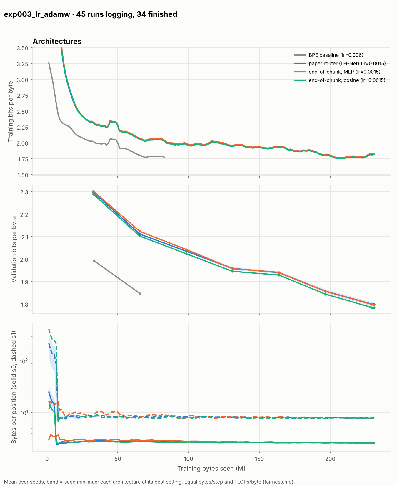
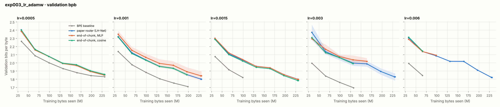
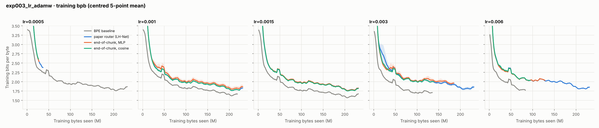
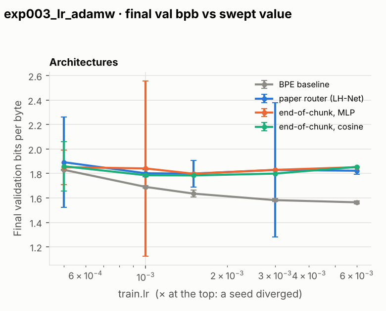
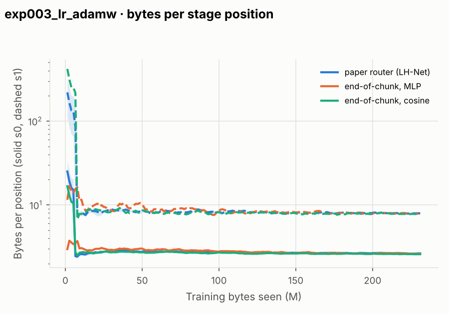

# Sweep report: exp003_lr_adamw

Spec `configs/search/exp003_lr_adamw.yaml` · fairness **tuned** · baseline **BPE baseline** · generated 2026-10-29 05:51 UTC

Runs: 11 absent, 34 done, 11 running, 4 started (of 60). Tables use finished seeds; ± is the 95% t-interval over seeds; Δ intervals are paired over seeds (same seed = same data order).

## Final validation bpb per architecture and setting

| architecture | setting | seeds | val bpb | Δ vs baseline (same setting) | soft bpb | acc_norm (%) | bytes/pos s0 | bytes/pos s1 |
|---|---|---|---|---|---|---|---|---|
| BPE baseline | lr=0.0005 | 3/3 | 1.830 ± 0.004 | — | 1.944 ± 0.009 | 28.9 ± 1.3 | — | — |
| BPE baseline | lr=0.001 | 2/3 | 1.690 ± 0.011 | — | 1.792 ± 0.069 | 29.2 ± 1.5 | — | — |
| BPE baseline | lr=0.0015 | 2/3 | 1.636 ± 0.029 | — | 1.740 ± 0.024 | 29.1 ± 3.0 | — | — |
| BPE baseline | lr=0.003 | 2/3 | 1.582 ± 0.012 | — | 1.681 ± 0.070 | 29.2 ± 6.7 | — | — |
| BPE baseline | lr=0.006 ★ | 2/3 | 1.564 ± 0.012 | — | 1.672 ± 0.044 | 29.5 ± 3.9 | — | — |
| paper router (LH-Net) | lr=0.0005 | 2/3 | 1.892 ± 0.371 | +0.063 [-0.292, +0.418] | 2.008 ± 0.359 | 29.5 ± 3.0 | 2.87 ± 1.19 | 8.48 ± 0.81 |
| paper router (LH-Net) | lr=0.001 | 2/3 | 1.802 ± 0.028 | +0.111 [+0.095, +0.128] | 1.937 ± 0.020 | 28.8 ± 1.2 | 2.62 ± 0.44 | 7.91 ± 1.87 |
| paper router (LH-Net) | lr=0.0015 ★ | 2/3 | 1.799 ± 0.109 | +0.164 [+0.084, +0.244] | 1.930 ± 0.079 | 29.4 ± 0.0 | 2.62 ± 0.54 | 7.80 ± 0.55 |
| paper router (LH-Net) | lr=0.003 | 2/3 | 1.829 ± 0.548 | +0.247 [-0.289, +0.783] | 1.956 ± 0.456 | 29.3 ± 0.0 | 2.79 ± 1.88 | 8.42 ± 4.61 |
| paper router (LH-Net) | lr=0.006 | 2/3 | 1.823 ± 0.027 | +0.258 [+0.243, +0.273] | 1.940 ± 0.074 | 29.2 ± 5.1 | 2.77 ± 0.52 | 8.34 ± 1.83 |
| end-of-chunk, MLP | lr=0.0005 | 2/3 | 1.852 ± 0.142 | +0.022 [-0.135, +0.180] | 1.990 ± 0.088 | 29.1 ± 1.5 | 2.64 ± 0.41 | 7.93 ± 2.92 |
| end-of-chunk, MLP | lr=0.001 | 2/3 | 1.841 ± 0.718 | +0.151 [-0.578, +0.880] | 1.965 ± 0.633 | 30.0 ± 3.6 | 2.76 ± 3.16 | 8.28 ± 9.68 |
| end-of-chunk, MLP | lr=0.0015 ★ | 1/3 | 1.798 (n=1) | +0.165 (n=1) | 1.928 (n=1) | 28.6 (n=1) | 2.60 (n=1) | 7.79 (n=1) |
| end-of-chunk, MLP | lr=0.003 | 1/3 | 1.830 (n=1) | +0.249 (n=1) | 1.954 (n=1) | 29.3 (n=1) | 2.91 (n=1) | 8.99 (n=1) |
| end-of-chunk, MLP | lr=0.006 | 1/3 | 1.852 (n=1) | +0.288 (n=1) | 1.971 (n=1) | 30.0 (n=1) | 3.04 (n=1) | 9.21 (n=1) |
| end-of-chunk, cosine | lr=0.0005 | 2/3 | 1.859 ± 0.202 | +0.030 [-0.156, +0.215] | 1.977 ± 0.073 | 29.3 ± 2.4 | 2.71 ± 0.97 | 8.15 ± 2.31 |
| end-of-chunk, cosine | lr=0.001 | 1/3 | 1.786 (n=1) | +0.096 (n=1) | 1.922 (n=1) | 29.9 (n=1) | 2.62 (n=1) | 8.07 (n=1) |
| end-of-chunk, cosine | lr=0.0015 ★ | 1/3 | 1.784 (n=1) | +0.151 (n=1) | 1.920 (n=1) | 29.3 (n=1) | 2.56 (n=1) | 7.84 (n=1) |
| end-of-chunk, cosine | lr=0.003 | 1/3 | 1.799 (n=1) | +0.218 (n=1) | 1.928 (n=1) | 28.9 (n=1) | 2.71 (n=1) | 8.35 (n=1) |
| end-of-chunk, cosine | lr=0.006 | 1/3 | 1.854 (n=1) | +0.291 (n=1) | 1.972 (n=1) | 29.3 (n=1) | 2.93 (n=1) | 8.84 (n=1) |

## Best setting per architecture (each at its best value; Δ and multiplier vs the baseline at its best)

| architecture | best setting | val bpb | Δ vs baseline (paired) | data multiplier vs baseline | note |
|---|---|---|---|---|---|
| BPE baseline | lr=0.006 | 1.564 ± 0.012 | — | — | best lr at the grid edge: extend the grid |
| paper router (LH-Net) | lr=0.0015 | 1.799 ± 0.109 | +0.235 [+0.138, +0.332] | 0.26x [0.25, 0.27] |  |
| end-of-chunk, MLP | lr=0.0015 | 1.798 (n=1) | +0.235 (n=1) | 0.26x [0.25, 0.26] |  |
| end-of-chunk, cosine | lr=0.0015 | 1.784 (n=1) | +0.221 (n=1) | 0.27x [0.26, 0.28] |  |

Data multiplier: baseline tokens needed to reach the architecture's val bpb ÷ its tokens, both in the stable phase (lr_factor = 1, before the WSD decay); power-law fit of the baseline's mean curve, bootstrap interval (hnet.eval.stats.data_multiplier).

## Chunk diagnostics (diag.json: blog English examples + FineWeb-Edu val docs)

| architecture | setting | s0 bytes/chunk | s1 bytes/chunk | s1 % cuts after space | s1 % word-internal | s1 % mid-UTF-8 |
|---|---|---|---|---|---|---|
| paper router (LH-Net) | lr=0.0015 | 2.63 ± 0.34 | 7.91 ± 1.20 | 22.5 ± 180.1 | 52.6 ± 97.0 | 0.64 ± 1.26 |
| end-of-chunk, MLP | lr=0.0015 | 2.64 (n=1) | 7.88 (n=1) | 5.4 (n=1) | 41.8 (n=1) | 1.42 (n=1) |
| end-of-chunk, cosine | lr=0.0015 | 2.59 (n=1) | 7.71 (n=1) | 11.1 (n=1) | 45.9 (n=1) | 1.10 (n=1) |
| *blog's improved H-Net (EXP-001, English)* | | | 7.0 | 91.9 | 0.0 | 0.0 |

## Figures

